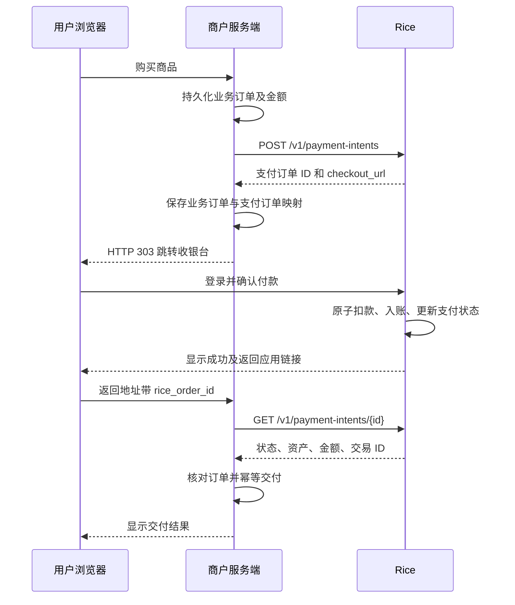

# Rice 积分支付集成指南

适用于第三方应用开发者及开发 Agent。接口与示例按 2026-11-12 的 Rice 实现核对。

- 测试站 API Base URL 为 `https://xjdao.net`。
- 在线 Demo 为 <https://xjdao.net/point-demo/>，目前收取 10 DEMO 积分。
- Demo 源码位于 rice-front 仓库的 `examples/point-payment-demo`，包括建单、跳转收银台、回跳查单与模拟交付。[Demo 目录与运行说明](https://github.com/xjdao2025/rice-front/tree/codex/rice-point-migration/examples/point-payment-demo)，[server.mjs 源码](https://github.com/xjdao2025/rice-front/blob/codex/rice-point-migration/examples/point-payment-demo/server.mjs)
- 机器可读接口定义供开发工具和 Agent 使用。[OpenAPI 3.1](openapi.json)
- 商户服务端创建订单，将用户浏览器跳到 Rice 收银台。用户在 Rice 登录并确认付款，商户服务端查到成功后交付。

## 1. 接入前准备

### 在页面申请 RICE_PAYMENT_KEY

个人收款应用通过登录账号自助注册，收款人是当前登录账号。注册入口位于“我的 → 积分支付应用”。[打开测试站注册页](https://xjdao.net/developer/payments)

1. 使用收款账号登录 `xjdao.net`，在“我的积分”确认已拥有需要收取的 Point 钱包。
2. 进入注册页，填写应用名称，选择收款积分，并填写自己应用的 HTTPS 返回地址，例如 `https://shop.example.com/rice/return`。
3. 点击“注册应用”。页面会生成应用卡片，显示应用 ID、积分 ID、收款钱包 ID 和返回地址。
4. 点击卡片中的“查看密钥”，再点击“复制密钥”。复制的完整值就是 `RICE_PAYMENT_KEY`。
5. 把密钥配置到商户服务端的环境变量或密钥存储，将卡片中的“积分 ID”配置为 `RICE_POINT_ID`。
6. 按本指南建单、跳转 Rice 收银台并查单，完成测试后再接入业务交付。

收款钱包余额可以为零。注册页只展示当前账号拥有且已启用的钱包；如果没有可选积分，先由该积分发行方或已有持有人向此账号分配或转入积分，再刷新注册页。付款人需要拥有同一种积分及足够的可用余额。

### 查看、重置与历史应用

页面默认隐藏密钥，应用所有者可以再次查看和复制。服务端加密保存可恢复副本，应用列表不返回密钥，密钥查看响应禁止缓存。前端页面隐藏密钥或切换到后台后，需要再次点击查看。

点击“重置密钥”并确认后，旧密钥会立即失效，所有使用该密钥的商户服务端都需要更新配置。重置保留原应用 ID、已有订单及幂等范围。如果只是迁移服务器，可再次查看原密钥并配置到新环境。

历史应用可能只保存了不可恢复的摘要，页面会提示先重置。运维注册的个人收款应用归收款账号所有。节点收款应用仍由运维注册和管理。

接入时请准备以下配置，并明确测试环境。

| 配置 | 用途 |
| --- | --- |
| 应用名称 | 收银台向付款人展示的名称 |
| 收款账号及 Point 钱包 | 确定收款人和积分资产 |
| 积分资产 ID `point_id` | 商户校验订单资产，保存为 `RICE_POINT_ID` |
| HTTPS 返回地址 `return_url` | 例如 `https://shop.example.com/rice/return` |
| 应用凭证 | 商户后端保存为 `RICE_PAYMENT_KEY` |
| 收银台 origin | 测试环境为 `https://xjdao.net`，用于校验跳转目标 |

一个应用绑定一个积分资产、一个收款钱包和一个返回地址。凭证标识应用，建单请求无需指定这些字段。支付接口采用单收款人和单一整数金额。Point 记账核心的多收款人、公开备注和私有备注能力，目前尚未通过第三方建单接口开放。

付款人须持有所需资产的个人钱包及足够可用余额。DEMO 与稻米是独立资产。登录账号有稻米余额，也需要 DEMO 余额才能购买当前 Demo 商品。付款人不能是订单的收款账号。

应用凭证只保存在商户服务端的环境变量或密钥存储中。浏览器使用 Rice 登录会话，在 Rice 收银台确认付款。商户服务端只使用自己的应用凭证。

### 运维侧注册

以下命令在 Rice 部署环境中由运维执行。第三方开发者无需数据库或部署权限。

先为已有收款人取得该资产的钱包，使用 `POINT_WALLET` JSON，字段为 `point_id`、`owner_type`（`user` 或 `node`）和 `owner_id`。

```sh
bin/rice eval 'Rice.Release.point_ledger("ensure-wallet")'
```

随后设置 `POINT_PAYMENT_APP`，内容形如以下 JSON，其中 `payee_account_id` 是上一步返回的钱包 ID。

```json
{
  "name": "示例商店",
  "payee_account_id": "<钱包 ID>",
  "return_url": "https://shop.example.com/rice/return"
}
```

```sh
bin/rice eval 'Rice.Release.point_ledger("register-payment-app")'
```

运维命令的注册结果包含 `app_id` 和明文 `credential`，应通过私密渠道交付凭证。个人应用的收款账号也可在注册页再次查看新版本加密保存的密钥。应用停用、启用和凭证轮换由运维设置 `POINT_PAYMENT_APP_ID` 后分别执行 `disable-payment-app`、`enable-payment-app`、`rotate-payment-credential`。轮换会使旧凭证失效，应协调更新商户服务端配置。

## 2. 完整支付流程



用户付款成功后点击“返回应用”回到商户。目前付款页不会自动回跳。用户关闭页面时，付款可能已经成功，商户仍应通过查单恢复交付。

## 3. 创建支付订单

```http
POST /v1/payment-intents
Authorization: Bearer <应用凭证>
Content-Type: application/json
```

```json
{"external_order_id":"order-20261112-001","amount":"10"}
```

| 字段 | 格式与约束 |
| --- | --- |
| `external_order_id` | 商户服务端生成，应用内唯一。UTF-8 字符串，1–255 字节，不可全空白或包含 NUL |
| `amount` | 规范的正整数字符串，范围 `1` 至 `9223372036854775807`。例如 `"10"` |

金额来自服务端的商品或订单数据。`"010"`、`"10.0"`、`"-1"`、JSON 数字 `10` 均无效。所有金额在服务端和数据库中按整数处理，JavaScript 使用字符串及 `BigInt`，避免 `Number` 精度损失。

成功及同参数重试都返回 HTTP **201**。

```json
{
  "data": {
    "id": "<Rice 支付订单 ID>",
    "external_order_id": "order-20261112-001",
    "status": "pending",
    "point_id": "<积分资产 ID>",
    "amount": "10",
    "expires_at": "2026-11-12T03:00:00.000000Z",
    "checkout_url": "https://xjdao.net/point-checkout/<不透明令牌>"
  }
}
```

`id` 是支付订单 ID，`transaction_id` 是到账后的记账交易 ID，两者用途不同。所有 ID 均按不透明字符串保存。

### 幂等与超时

幂等范围是同一个应用的 `external_order_id`。

- 相同外部订单号、相同金额返回同一支付订单。重试可能返回重新签发的 `checkout_url`。
- 相同外部订单号、不同金额返回 HTTP 409 `idempotency_conflict`。
- 网络超时后，使用原外部订单号及原金额重试。保留业务订单与支付订单的持久化映射。
- 重试不会延长订单有效期。已过期订单仍对应原外部订单号。允许重新购买时，应创建新的支付尝试 ID，并保留它与原业务订单的关联。

应用重新注册会改变幂等范围。凭证轮换仍属于同一应用。

### 浏览器跳转

保存订单映射后，校验返回链接的 HTTPS origin 和路径，再给浏览器返回 HTTP 303。

```js
const checkout = new URL(payment.checkout_url)
if (checkout.origin !== process.env.RICE_CHECKOUT_ORIGIN ||
    !checkout.pathname.startsWith('/point-checkout/')) {
  throw new Error('Unexpected Rice checkout URL')
}
res.writeHead(303, { location: checkout.href, 'cache-control': 'no-store' })
res.end()
```

`checkout_url` 原样使用，不拼接用户凭证或支付参数。将它视为订单专用链接，避免写入公开日志。

## 4. 返回应用与服务端查单

Rice 在注册的返回地址上附加 `rice_order_id` 查询参数，保留原有查询参数。注册返回地址时请为此参数保留名称。

```text
https://shop.example.com/rice/return?rice_order_id=<Rice 支付订单 ID>
```

回跳参数用于定位支付订单。商户收到回跳后，先从自己的数据库查找订单映射并验证当前访问者能查看该业务订单，再在服务端调用查单接口。

```http
GET /v1/payment-intents/<Rice 支付订单 ID>
Authorization: Bearer <应用凭证>
```

成功返回 HTTP **200**。此接口只允许查询当前应用自己的订单，返回数据不含 `checkout_url`。

```json
{
  "data": {
    "id": "<Rice 支付订单 ID>",
    "external_order_id": "order-20261112-001",
    "status": "succeeded",
    "point_id": "<积分资产 ID>",
    "amount": "10",
    "expires_at": "2026-11-12T03:00:00.000000Z",
    "transaction_id": "<Point 记账交易 ID>"
  }
}
```

交付前同时核对以下条件。

1. `id` 与本地保存的支付订单 ID 一致。
2. `external_order_id` 与本地支付尝试一致。
3. `point_id` 与商户配置的积分资产一致。
4. `amount` 与本地业务订单的规范整数字符串一致。
5. `status === "succeeded"`，且 `transaction_id` 存在。

```js
function verifyPaid(payment, localOrder) {
  if (payment.id !== localOrder.ricePaymentId ||
      payment.external_order_id !== localOrder.paymentAttemptId ||
      payment.point_id !== process.env.RICE_POINT_ID ||
      payment.amount !== localOrder.amount) {
    throw new Error('Payment does not match the local order')
  }
  return payment.status === 'succeeded' &&
    typeof payment.transaction_id === 'string' && payment.transaction_id.length > 0
}
```

同一业务订单的回跳、刷新、后台查单可能并发执行。持久化 `transaction_id`，对支付交易 ID 和业务订单交付分别设置唯一约束，用数据库事务保证每笔支付只处理一次、每个业务订单只交付一次。外部发货或服务开通可通过 outbox 重试，外部调用也使用稳定的幂等标识。

### 推荐本地字段

| 字段 | 用途 |
| --- | --- |
| `business_order_id`、`customer_id` | 商品订单及访问权限 |
| `payment_attempt_id` | 发给 Rice 的 `external_order_id`，同一应用内唯一 |
| `rice_payment_id` | Rice 支付订单 ID，应用内唯一 |
| `point_id`、`amount` | 创建时锁定的资产及规范金额 |
| `rice_transaction_id` | 成功记账交易 ID，交付时加唯一约束 |
| `payment_status`、`expires_at` | 最近一次服务端核验结果 |
| `fulfillment_status` | 未交付、交付中、已完成或重试中，业务订单的交付记录唯一 |

## 5. 状态与错误处理

| 状态 | 处理 |
| --- | --- |
| `pending` | 等待用户在 Rice 确认。查单本身不会扣款 |
| `succeeded` | 核对全部订单字段及交易 ID 后交付 |
| `expired` | 本次支付尝试已过期，展示重新购买入口 |
| `canceled` | 按已关闭处理。当前公开 API 未提供取消操作 |

订单有效期为创建后 **30 分钟**，以 `expires_at` 为准。收银台签名链接的校验时限为 24 小时，付款仍受订单 30 分钟有效期约束。已经成功的支付不会因时间经过变成过期。

商户接口的错误响应采用以下结构。

```json
{"error":"idempotency_conflict"}
```

| HTTP | `error` | 商户处理 |
| --- | --- | --- |
| 401 | `invalid_app_credential` | 检查环境、凭证、应用启用状态或轮换结果 |
| 404 | `not_found` | 检查支付订单 ID 及所属应用 |
| 409 | `idempotency_conflict` | 核对本地订单金额及外部订单号 |
| 422 | `invalid_order` | 修正字段格式与金额范围 |
| 422 | `payee_unavailable` | 联系运维检查收款钱包与积分资产状态 |
| 5xx / 网络超时 | 响应可能不确定 | 保留当前支付尝试，查单或按原参数重试建单 |

余额不足、个人钱包不存在、向自己付款等问题由 Rice 收银台处理。商户只根据服务端查单结果判断是否交付。当前接口没有 `failed` 状态。一次确认失败后，订单可能仍为 `pending`。

当前公开商户接口只有建单和查单。尚未提供 webhook、自动扣款授权、退款、取消、修改金额、订单列表以及按外部订单号查单接口。用户未回跳时，可由商户后台针对已保存的支付订单做有界退避轮询。为成功待交付的订单保留恢复任务，即使本地等待时间已经超过 `expires_at` 也要允许最后一次服务端核验。

## 6. curl 快速联调

在私密终端中事先设置 `RICE_PAYMENT_KEY`，不要把真实密钥提交到仓库。下面的外部订单号应替换为本地已保存的支付尝试 ID。

```sh
export RICE_URL=https://xjdao.net
curl --fail-with-body --silent --show-error \
  --connect-timeout 5 --max-time 15 \
  -H "Authorization: Bearer $RICE_PAYMENT_KEY" \
  -H 'Content-Type: application/json' \
  --data '{"external_order_id":"integration-attempt-001","amount":"10"}' \
  "$RICE_URL/v1/payment-intents"
```

保存响应的 `id` 与 `checkout_url`，在浏览器打开收银台并确认支付。随后将下例 ID 换成响应中的支付订单 ID。

```sh
curl --fail-with-body --silent --show-error \
  --connect-timeout 5 --max-time 15 \
  -H "Authorization: Bearer $RICE_PAYMENT_KEY" \
  "$RICE_URL/v1/payment-intents/<Rice-payment-id>"
```

## 7. 运行当前 Demo

源码、README 和环境变量说明均维护在 rice-front 的 `examples/point-payment-demo` 目录。[Demo GitHub 目录](https://github.com/xjdao2025/rice-front/tree/codex/rice-point-migration/examples/point-payment-demo)，[完整服务端实现](https://github.com/xjdao2025/rice-front/blob/codex/rice-point-migration/examples/point-payment-demo/server.mjs)

Node.js 22+ 可直接运行，无第三方依赖。先在注册页为自己的收款账号创建应用，返回地址使用自己部署的 Demo 域名。

```sh
git clone --branch codex/rice-point-migration https://github.com/xjdao2025/rice-front.git
cd rice-front/examples/point-payment-demo
export RICE_URL=https://xjdao.net
# 先通过安全方式设置 RICE_PAYMENT_KEY。
node server.mjs
```

默认监听 `127.0.0.1:19500`。默认返回地址应注册为自己站点的 `/return`。

部署在路径前缀下时，还可设置 `DEMO_PATH=/point-demo`、`PORT=19500` 和 `DEMO_BIND`。反向代理需要移除该路径前缀再转发到 Node 服务，注册返回地址则包含前缀。例如线上为 `https://xjdao.net/point-demo/return`。

Demo 用内存 Map 保存订单及交付状态，重启会丢失。商品发放通过页面文案模拟。正式接入应按第 4 节使用持久化订单、交付唯一约束及访问权限校验，并增加 `point_id` 的校验。现有 Demo 已校验订单 ID、外部订单号、金额和成功交易 ID。

## 8. 给开发 Agent 的执行指引

将本节及 `openapi.json` 一起提供给 Agent。接入授权为商户侧开发，扣款确认由用户在 Rice 页面完成。

Agent 可参考 Demo 中的 `rice()` API 客户端、`POST /buy/*` 建单与跳转，以及 `GET /return` 查单及模拟交付逻辑。阅读示例后，按第 4 节补齐持久化、订单访问权限、资产校验和交付唯一约束。[Demo 服务端源码](https://github.com/xjdao2025/rice-front/blob/codex/rice-point-migration/examples/point-payment-demo/server.mjs)

### 输入清单

```text
RICE_API_BASE_URL=https://xjdao.net
RICE_CHECKOUT_ORIGIN=https://xjdao.net
RICE_POINT_ID=<运维提供的资产 ID>
RICE_PAYMENT_KEY=<通过密钥存储提供，禁止写入生成的源码、文档或日志>
MERCHANT_RETURN_URL=https://<商户域名>/rice/return
```

还需要明确商品定价规则、本地订单存储、当前用户身份及交付动作。缺少应用注册、凭证或资产 ID 时，先完成不依赖这些配置的本地代码，再请收款账号持有人到注册页创建应用并提供配置，或向运维申请节点收款应用。

### 实现步骤

1. 阅读 OpenAPI，确认只使用 `POST /v1/payment-intents` 和 `GET /v1/payment-intents/{id}` 作为商户调用入口。
2. 在商户服务端创建 API 客户端，设置 Bearer 认证、超时和响应校验，拒绝跟随意外的 API 重定向。密钥从运行环境读取。
3. 建立持久化业务订单及支付尝试。金额在服务端决定，保存为规范整数文本。
4. 为购买入口接入商户已有的登录、订单归属和 CSRF 校验。建单前保存稳定的 `external_order_id`。建单成功保存 Rice ID，再校验并重定向到收银台。
5. 实现注册返回地址，校验本地订单访问权，查单后逐项核对资产、金额、订单 ID、状态及交易 ID。
6. 用事务及唯一约束实现幂等交付，并接入后台查单和交付恢复。
7. 以测试积分验证下列验收项，记录 HTTP 状态和订单状态，隐藏所有密钥与收银台令牌。

### 验收清单

- [ ] 相同外部订单号及金额重试，返回同一个 Rice ID。
- [ ] 相同外部订单号但改金额，返回 409。
- [ ] 数字型金额、前导零、负数及小数被拒绝。
- [ ] 用户在 Rice 核对积分种类和收款人，确认后订单为 `succeeded` 且有 `transaction_id`。
- [ ] 伪造回跳参数、替换其他用户的订单、仅访问返回页面，都无法取得未购买的商品。
- [ ] 其他应用无法查到本应用订单。
- [ ] 刷新、多标签页和并发恢复任务最终只交付一次。
- [ ] 网络超时后沿用同一支付尝试重试。
- [ ] 用户关闭收银台或应用重启后，后台可恢复查单与交付。
- [ ] 余额不足及过期订单不会触发交付。
- [ ] 可用与不足余额用不同资产分别验证，避免混淆 DEMO 与稻米。
- [ ] 浏览器包、源码、日志和回跳 URL 中没有应用凭证。

Agent 应直接使用响应中的不透明 ID 和收银台链接。禁止基于文档示例推测真实 ID、凭证、付款成功结果或未实现的接口。第三方支付接入不需要 Agent 代替用户调用 Rice 的浏览器确认接口。
